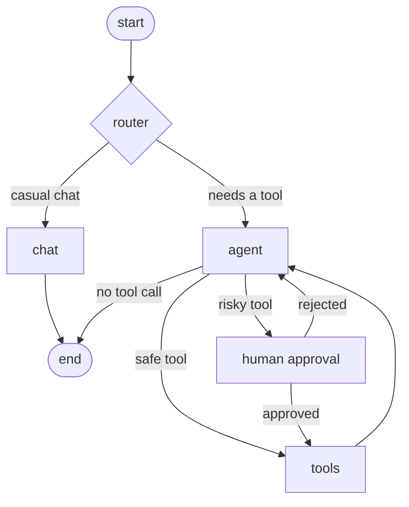

# AI Engineering Portfolio

Hands-on projects while learning to build AI applications with **LangChain, LangGraph and
LangFlow**, using **RAG, vector databases and agents**. Everything runs **locally and free**
with [Ollama](https://ollama.com), so no paid API keys are needed.

Each module is a small, runnable project with its own README that records what I built,
what I measured, and the problems I hit along the way.

## What's inside

| # | Module | What I built | Status |
|---|---|---|---|
| 01 | [LangChain core](module-01-langchain-core/) | Prompt chains, streaming, structured output; a job-posting parser returning typed JSON | Done |
| 02 | [RAG](module-02-rag/) | Document loading, chunking, embeddings, retrieval, grounded answers with citations | Done |
| 03 | [Vector databases](module-03-vector-databases/) | Chroma, FAISS, Qdrant and pgvector compared; idempotent indexing | Done |
| 04 | [Agents and tools](module-04-agents/) | Hand-written agent loop, tool calling, guardrails, a tool-selection eval | Done |
| 05 | [LangGraph](module-05-langgraph/) | Stateful graph with a router, memory across turns, and human approval | In progress |
| 06 | LangFlow | Visual prototype of the same pipeline, exported and served | Planned |
| 07 | Capstone | Document Q&A agent served as a FastAPI service | Planned |

## Highlights

- **RAG fixes real mistakes.** Asked "Explain RAG" with no context, the local model described
  a gene. With retrieval it answered from my documents and cited the source files.
- **Measured, not assumed.** Small models over-call tools. In a tool-selection test, accuracy
  on "no tool needed" questions went from 0/2 to 2/2 after adding a system message and a
  narrower tool description. (Module 04)
- **Idempotent indexing.** Re-running the indexer adds nothing new and removes stale chunks,
  using content-hash IDs. (Module 03)
- **Human in the loop.** The agent pauses before sending an email and resumes only after
  approval. (Module 05)

## Architecture (Module 05 agent)



## Project structure

```
ai-engineering/
├── README.md
├── pyproject.toml                  # installs the shared `common` package
├── .env.example                    # model names; copy to .env
├── .gitignore
├── common/
│   ├── llm.py                      # get_llm(), get_embeddings(): one place to change models
│   └── documents.py                # load_documents(), split_documents()
├── module-01-langchain-core/
├── module-02-rag/
│   └── sample_data/knowledge_base/
├── module-03-vector-databases/
├── module-04-agents/
│   └── my_tools.py                 # calculator, clock, document search
└── module-05-langgraph/
    └── agent_graph.py              # router + agent + tools + approval
```

## Quickstart

Requires Python 3.10+ and [Ollama](https://ollama.com).

```bash
# 1. Pull local models
ollama pull llama3.1:8b          # use llama3.2:3b on low-RAM machines
ollama pull nomic-embed-text     # embeddings

# 2. Python environment
python -m venv .venv
source .venv/bin/activate        # Windows: .venv\Scripts\activate
pip install -e .
pip install langchain-chroma langchain-qdrant qdrant-client faiss-cpu

# 3. Optional config
cp .env.example .env             # Windows: copy .env.example .env

# 4. Run a module (always from the repo root)
python module-02-rag/05_rag_chain.py
```

Module 03's pgvector step needs Docker:
`docker run --name pgvector -e POSTGRES_PASSWORD=pass -p 5432:5432 -d pgvector/pgvector:pg16`

## Tech

Python, LangChain, LangGraph, LangFlow, Ollama (llama3.1, nomic-embed-text), Chroma, FAISS,
Qdrant, PostgreSQL + pgvector, Pydantic, FastAPI (capstone).

## What I learned

- A grounded prompt ("answer ONLY from the context") matters as much as retrieval quality.
- Chunk size, overlap and the distance cutoff need calibration against real queries.
- Tool descriptions are an interface: precise wording, including when NOT to use a tool, changes behaviour.
- Agents fail quietly, so small evaluation sets pay for themselves.
- Pausing for human approval needs a checkpointer, and the paused node re-runs from its start on resume.

## Author

TODO your name, LinkedIn or portfolio link.