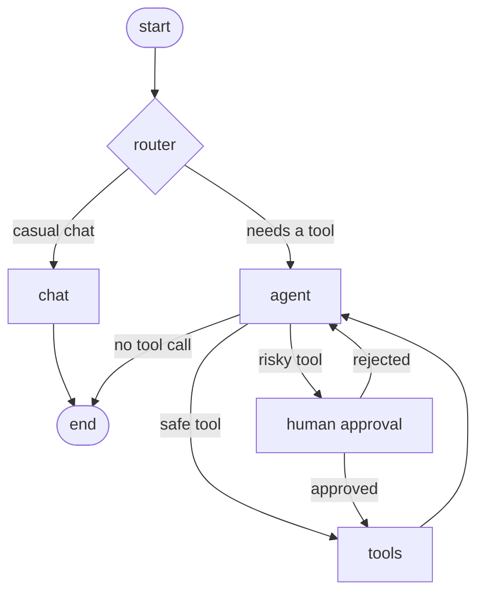

# Module 05: LangGraph

The Module 04 agent loop rebuilt as an explicit graph, with a router, memory across turns,
and a human-approval step before risky actions. Runs locally with Ollama.

## The graph



TODO: replace or add the diagram generated from my code with
`graph.get_graph().draw_mermaid()` (rendered at mermaid.live), saved as `graph.png`.

## Scripts

| File | What it demonstrates |
|---|---|
| `01_graph_basics.py` | State, nodes, edges, a reducer, and a conditional edge, with no LLM |
| `agent_graph.py` | The full graph builder: router, agent, tools, approval |
| `02_run_agent_graph.py` | Running the graph and reading the message trace |
| `03_memory.py` | A checkpointer with separate conversation threads |
| `04_human_approval.py` | Pausing at `interrupt()` and resuming with the human's answer |

## Concepts

| Concept | In this project |
|---|---|
| **State** | `MessagesState`: one `messages` list, merged by an append reducer |
| **Node** | `chat`, `agent`, `tools`, `approval`: functions that return state updates |
| **Conditional edge** | `route_start` (chat or agent) and `after_agent` (end, tools, or approval) |
| **Checkpointer** | `InMemorySaver` stores state per `thread_id`, which gives memory across turns |
| **Interrupt** | `approval` calls `interrupt()` and the graph pauses until the caller resumes it |

## How it works

1. **Router.** A structured-output call classifies each new message as needing a tool or not.
   Greetings and general chat skip the tools entirely. If the router call fails, it defaults
   to the agent path, so a failure never blocks a real request.
2. **Agent loop.** `agent` calls the model with tools bound. If it requested tools, they run
   in `tools` and control returns to `agent`, repeating until it answers without a tool call.
3. **Approval.** If any requested tool is on the `RISKY` list (here, `send_email`), the graph
   pauses and shows the pending action. Resuming with "yes" runs the tool; any other answer
   rejects it and tells the model not to retry.

## Run (from the repo root)

```bash
python module-05-langgraph/02_run_agent_graph.py
python module-05-langgraph/03_memory.py
python module-05-langgraph/04_human_approval.py
```

## Results

**Routing.** Casual message "Say hello in one sentence." took the path: TODO (expected: chat,
no tool calls). "What is 365 * 24?" took the path: TODO (expected: agent, calculator).

**Memory.** After telling thread `alice` my name, asking "What is my name?" on the same thread
returned: TODO. The same question on thread `bob` returned: TODO.

**Human approval.**

| My answer | What happened |
|---|---|
| `yes` | TODO (expected: email tool ran and the model confirmed it) |
| `no` | TODO (expected: no email sent and the model acknowledged the rejection) |

**Comparison with Module 04's single-call agent** (same test questions):

| Architecture | Needs-tool accuracy | No-tool accuracy |
|---|---|---|
| Module 04: one model call decides | TODO | TODO |
| Module 05: router, then agent | TODO | TODO |

## Design notes

- **The router must know about every tool.** An early version listed only math, time and
  documents in the gate's description, so "send an email" would have been routed to plain
  chat and the email tool would never be offered. The gate's description and the system
  prompt have to stay in sync with the tool list.
- **Interrupts re-run the paused node.** On resume, `approval` restarts from its first line
  and `interrupt()` returns the human's answer. Anything before `interrupt()` runs twice, so
  that code must be free of side effects.
- **A rejection must answer every tool call.** When the human says no, the graph adds a
  tool message for each requested call. Leaving any unanswered would make the conversation
  invalid for the next model call.
- **Interrupts need a checkpointer and a `thread_id`.** The paused state has to be saved somewhere,
  and resuming has to target the same thread.
- **Memory grows without bound.** Every turn adds messages, so long conversations will
  eventually exceed the model's context window. Trimming or summarising old messages is the
  next step.

## Limitations

- `InMemorySaver` loses everything when the process exits (SQLite checkpointer: TODO, done or not).
- Approval is a console prompt; a real app would surface it in a UI.
- The router is another model call, so it adds latency and can itself be wrong.
- The test set is small, so accuracy numbers are indicative only.

## Problems hit and fixed

TODO: add anything that went wrong (for example, the model not calling `send_email`, or
mangled tool arguments) and how you diagnosed it with `print_trace`.